# Procurement Navigator

A one-day prototype that helps a supplier (Lantern AI) get through enterprise vendor reviews. It
reads everything about a deal: questionnaire rounds, customer emails, Slack, drafts, old answers
for other customers, and evidence. From that it keeps a current answer to the five questions in
the brief for every deal: **what is required** (asks merged across rounds and channels), **what is
known** (each fact with the source that settles it), **what is unresolved** (unconfirmed,
conflicting, undecided, out of date), **what is blocking** (root causes and the chains
leading to them), and **what to do next** (ranked actions, grouped per person). Jai, the only
approver, signs off every answer before it leaves. The app also tracks what was sent to each
customer, so when a fact changes it can show that an update is owed. The demo has two deals running
at once, Acme National Bank and Northstar Telecom.

## Quickstart

```bash
uv sync
cp .env.example .env          # then put your OPENROUTER_API_KEY in .env
.venv/bin/streamlit run app.py
```

The base case runs **offline from the committed LLM cache** (`cache/llm/`), so you don't need a key
to open the app and walk through it. A key is only needed for inputs the cache has never seen,
such as text you paste into *Add input*. **Never commit the key.** `.env` is gitignored, and only
`.env.example` (with no key) is in the repo.

Other entry points: `.venv/bin/python -m evals.run` (the eval harness), `.venv/bin/python -m pytest`
(rule tests), `.venv/bin/python scripts/print_state.py` (state dump).

## How it works

The full design is in [docs/ARCHITECTURE.md](docs/ARCHITECTURE.md): data model, sequence diagrams
for first load, a new questionnaire round, a fact changing after we answered, and the 10-second
approval.



Every change triggers a full rebuild from the inputs, and inputs are never edited. The pipeline is
load → extract (LLM) → merge asks into requirements (LLM) → resolve facts (rules) → plan (rules),
and drafting (LLM, checked by rules) runs on request for one requirement. It is a fixed pipeline,
not an agent: every LLM step is narrow and its output is checked by code.
Model results are cached by a hash of the prompt, so a rebuild is fast and returns the same result
every time. Only new input goes to the network.

## What is automated, what is fixed rules, what is human

| | Does | Why it sits here |
|---|---|---|
| **LLM** (GPT-6.1 Terra via OpenRouter, medium reasoning, strict JSON) | Pulls claims and asks out of messy text, **each with an exact quote**. Quotes that are not in the source are dropped. Maps claims to catalog facts. Merges asks into requirements. Matches later rounds (repeat / repeat with changes / new). Labels whether two claims agree. Drafts answers from facts only. | These steps need reading comprehension. The output is always tied to a quote or an id the code can check, and code rejects ids the model was not shown. |
| **Fixed rules** (`pn/resolve.py`, `pn/planner.py`, `pn/drafting.py`, `config/*.yaml`) | Questionnaire rows and the 37 blank controls (parsed by code). Draft answers already in the sheet, attached as hints to the facts of their requirement. Trust tier of every claim, which claim wins, conflicts, staleness and expiry, blocker chains, requirement status, ranked actions, waits and delays, updates owed. The draft checker (every sentence cites verified facts of this requirement, no hints, approval off on any error). Reused question numbers. Stable requirement ids. | These decisions have to be explainable, repeatable, and editable by Jai as settings. A model never settles a conflict or fills a gap. A gap becomes *Pending: owner X*. |
| **Humans** | Jai approves every answer that leaves and marks it sent. Owners confirm facts. Customers state their own requirements. | Jai is accountable for what the customer is told, and only the customer can say what they require. |

## What we learned from Jai, and what it changed

| Finding (from talking to Jai) | What it changed in the design |
|---|---|
| Questionnaires arrive in rounds that repeat earlier questions with additions, and question numbers can be reused | Later rounds are matched **by meaning**, not by number, into repeat / repeat with changes / new. A reused number that now asks something else gets flagged by code. Requirement ids come from the first ask (`acme:Q-004`), so they stay stable as rounds and emails arrive. |
| Answers are scattered across Slack, email and past deals | One catalog of facts, with claims coming from every channel. Another customer's answers (Meridian, BluePeak) are kept as **hints that never count**, and a draft copied from one is flagged. |
| Recency matters: a 6-month-old pen test report is useless, so renew early | `max_age_days` per fact (pen test 183 days) and stated expiry dates. Stale or expired evidence is *out of date* and becomes a "renew" action. Anything expiring within 45 days, or before a deal's target date, shows up as a warning before the customer asks. |
| He wants sources and citations so he can approve in 10 seconds, and he trusts Vanta evidence most | Every sentence in a draft cites claims, shown with their quotes, and the code checker flags uncited sentences, unverified facts and hint sources. Four trust tiers put the evidence store first. |
| Monday morning he wants deal state, what he must do, blockers, waiting on, delays and next moves | The **Monday briefing** screen has exactly those sections, covering all deals. |
| Answers change mid-deal (SOC 2 in progress becomes final), and the customer must be told | The ledger stores a snapshot of the facts behind each sent answer. Once a fact changes and the new value is verified, the planner raises **update owed**. Before it is verified, the sent answer is shown as **at risk**. |
| There is no central record of what was sent | Append-only ledger (`state/ledger.jsonl`) with two entry types: `sent` (an approved version, with a fact snapshot) and `asked`. |
| Jai is the only approver | Nothing is sent without his approval of an exact version. Actions batch one message per person, ranked by how much they unblock. |
| Deals take 2–3 months | Waits are tracked against each person's usual reply time, deadlines and expiry dates are checked against the as-of date, and you can move the as-of date to see what lapses. |

## Tradeoffs and limits

- **Connectors are mocked.** Case folders map to systems (email, Slack, Drive, Vanta) through
  `config/deals.yaml`. New inputs arrive as JSON files in `state/inbox/` through the *Add input* screen.
  There is no real Vanta, Slack or email integration.
- **The fact catalog is hand-written** (`config/catalog.yaml`, 32 facts), but it is about the
  supplier in general (SOC 2, retention, residency, providers), not about Acme. It grows when a new
  kind of question appears. Requirements that fit no fact show as *unmapped*, so the gap is visible.
- **The LLM's judgment on merging and matching is cached but not perfect.** The evals check the
  known cases, but a different wording could be merged or matched differently. Code limits the
  damage: unknown ids are rejected, every ask must land somewhere, and reused numbers are flagged.
- **Value comparison is coarse.** Token equality first, then a model label (agree / adds detail /
  conflicts / different aspect). It does not reason about units or ranges. An owner who says more
  than the evidence on file (word check in code) makes a document fact conflicting, which is how
  "remediated later" vs "findings open" is caught.
- **Draft answers attach to every fact of their requirement.** "30 days?" in Q-004 is compared with
  each retention fact, so a multi-fact question can raise more than one flag.
- **No second model check of citations.** Jai reads the quoted evidence under each sentence; code
  checks that citations exist, are verified facts of this requirement and are not hints.
- **Rebuild everything, every time.** That is simple and consistent at this size, but it would need
  incremental resolution at hundreds of deals.
- **No auth, no multi-user, no audit signing.** The ledger is a local JSONL file, and anyone using
  the app counts as Jai.
- Dates without a year are read as `context_year` (2026). A real email connector would provide timestamps.

## Adapting to a different customer

- **Data, not code.** A new deal is a folder plus an entry in `config/deals.yaml`. Northstar runs on
  the same code as Acme with no changes, and has different asks (tool authorization, employee data,
  Records Management, a Nov 16 launch, AI Governance meeting on Wednesdays).
- **Company facts and deal facts are separate.** SOC 2, insurance and pen test are settled once and
  shared by every deal. Region, providers and retention are settled per customer. Renewing
  insurance once updates every deal.
- **The catalog grows.** A new kind of question means adding a fact (owner, proof type, max age,
  dependencies) in YAML.
- **Policies are settings.** Trust tiers (four: evidence, owner confirmed, plan or chat, hint), max ages, warning windows, reply times and team-to-person
  mapping live in `config/policy.yaml`. A customer with a stricter evidence age, or a team with a
  different owner, is a config edit.
- **Each customer's reading** of an ask ("Acme separates storage from processing location") is kept
  per requirement, so the same fact can be phrased differently for different customers.

## Evals

```bash
.venv/bin/python -m evals.run
```

The harness builds the state, then scores it against a hand-written answer key
(`evals/expectations.py`). It covers the traps (other-customer answers, draft answers, the 37 blank
template controls, generic docs), evidence and time (expired, stale, unproven), root causes,
requirements discovery, round 2 matching per question, and the full six-input story with a
temporary ledger. It uses the cache offline first and only goes online on a cache miss. Inputs it
adds are always removed, and it never touches `state/ledger.jsonl`. Results go to
[evals/results.md](evals/results.md).

**Latest: 36 / 36 pass**, including `pen_test_remediation` (owner says fixed, evidence shows the
findings open, so it is not verified).

## Repo map

```
app.py                     Streamlit UI: Monday briefing, Deal (5 questions + fact detail + rounds), Approvals, Add input
pn/engine.py               build(): load -> extract -> merge requirements -> attach sheet drafts -> resolve -> plan
pn/sources.py              mock connectors, inbox, questionnaire parsing (template rows detected by code)
pn/extract.py              LLM: claims + asks with exact quotes
pn/requirements.py         LLM: merge asks into requirements; match later rounds. Code: stable ids, reused numbers
pn/resolve.py              rules: trust tiers, winner, conflicts, out of date, blockers (+ LLM agree labels)
pn/planner.py              rules: requirement status, ranked actions, waits, delays, updates owed
pn/drafting.py             LLM: draft from facts only; code checks every citation
pn/ledger.py               append-only record of sends and asks
pn/llm.py                  OpenRouter client, strict JSON, disk cache keyed by prompt hash
config/                    catalog.yaml (facts), policy.yaml (tiers, ages, people), deals.yaml (deals, connectors)
data/cases/                the two deal folders (Acme, Northstar)
data/company/              company-wide sources (notes from talking to Jai)
data/simulated/            round 2 questionnaire and the six demo inputs
cache/llm/                 committed model cache (base case runs offline)
state/                     inbox/ (added inputs) and ledger.jsonl (both gitignored)
evals/                     run.py, expectations.py (answer key), results.md
tests/                     rule tests
docs/                      brief.pdf, ARCHITECTURE.md, DEMO.md, ADAPTABILITY.md (third customer test), INTERVIEW_PREP.md, explainer.html (start here), why.html (decisions), diagrams/
scripts/                   demo_story.py, print_state.py
```
