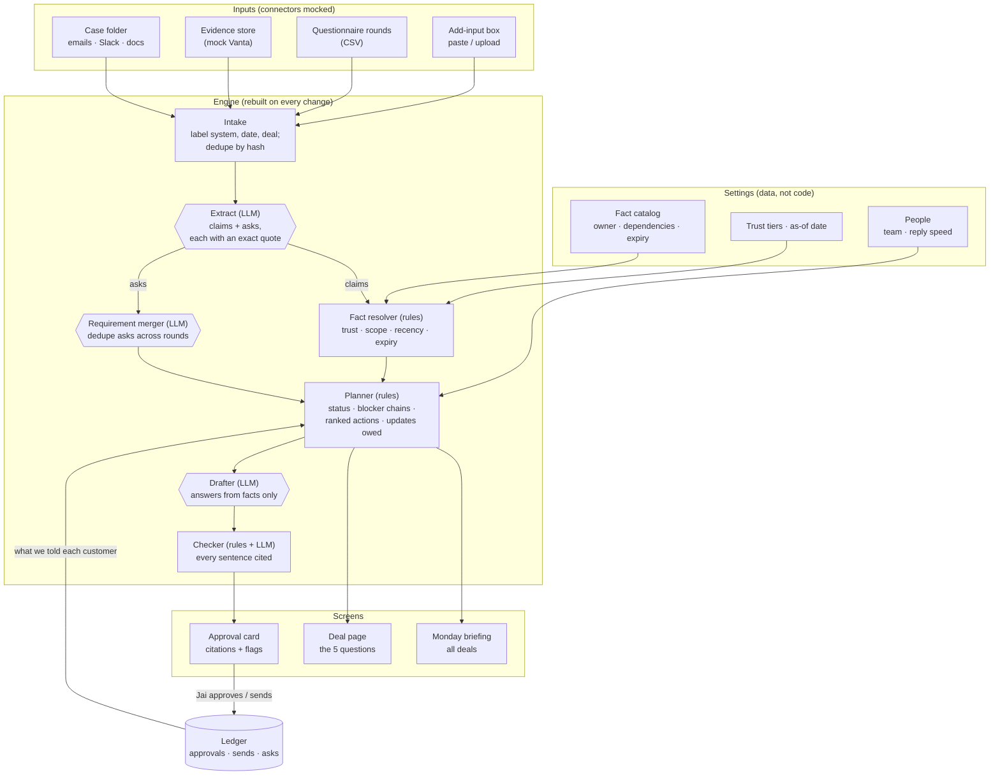
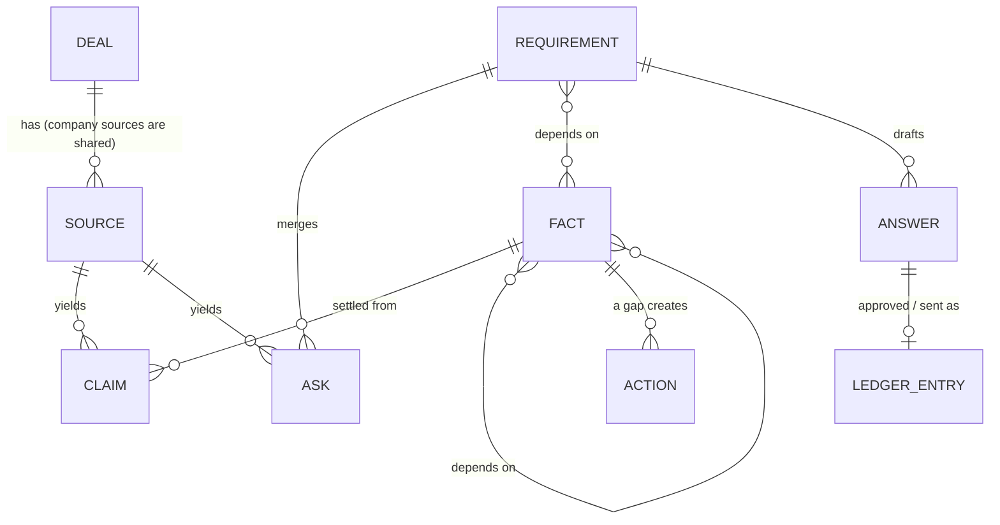
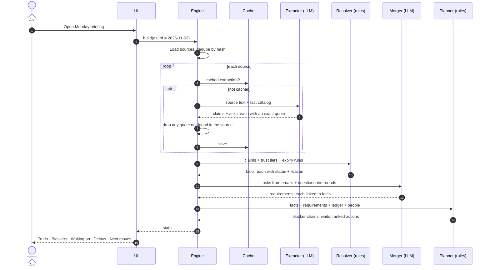
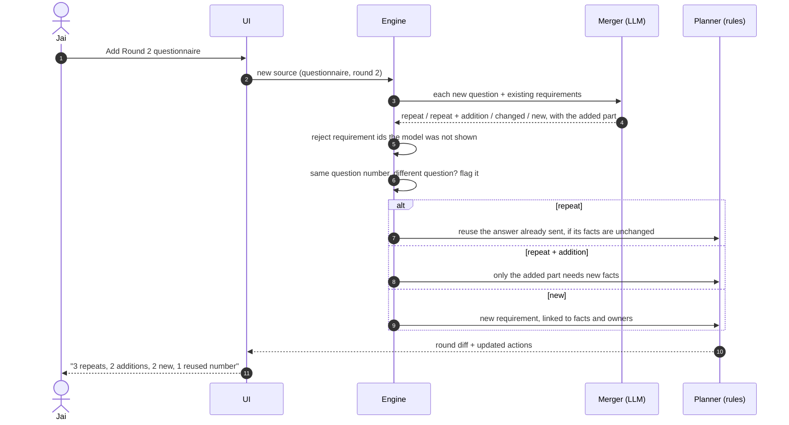
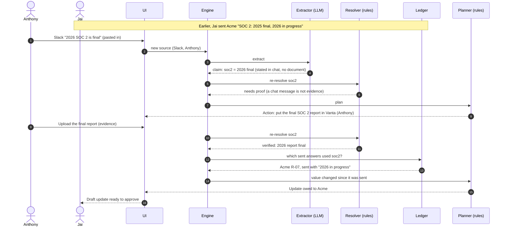
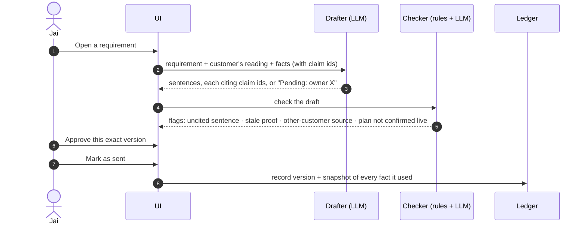

# Architecture

Procurement Navigator keeps an always-current picture of every vendor-review deal and turns it into
next actions. It answers the brief's five questions for each deal: what is required, what is known
(with proof), what is unresolved, what is blocking, and what to do next.

The whole state is **rebuilt from inputs every time**. Inputs are never edited. LLM results are
cached by content hash, so a rebuild is fast and gives the same answer twice.

Colour key in the diagrams: **LLM** steps are hexagons, **fixed rules** are rectangles, people are actors.

## 1. The big picture

## 2. Data model

| Object | What it is | Example |
|---|---|---|
| Source | One input, never edited | `03_internal/internal_messages.txt` (Slack) |
| Claim | One statement pulled from a source, with its exact quote | "app logs 14 days", quote "App logs intended 14 days.", kind *planned* |
| Fact | The current answer to one thing, decided by rules | `acme · retention_app_logs = 14 days`, status *needs confirmation* |
| Ask | One thing a customer asked, in one place | Round 1 Q-004, or one sentence of Elena's email |
| Requirement | One customer ask merged across rounds and channels | "Retention by data type", from Q-004 + Elena's email |
| Answer | A drafted answer: sentences, each citing claims or marked *pending* | |
| Ledger entry | A human action: approved, sent (with a fact snapshot), asked, decided | |
| Action | Worked out by the planner, never typed in | "Ask Anthony to confirm 4 config facts" |

## 3. Sequence: first load (Monday morning)

## 4. Sequence: a new questionnaire round arrives

## 5. Sequence: a fact changes after we answered

## 6. Sequence: the 10-second approval

## What is automated, what is fixed, what is human

| LLM (GPT-6.1 Terra, medium reasoning) | Fixed rules | Humans |
|---|---|---|
| Pull claims and asks from messy text, with exact quotes | Trust tier of every claim | Jai approves every answer that leaves |
| Map each claim to a fact in the catalog | Which claim wins, and why | Owners confirm facts |
| Merge asks into requirements; match new rounds | Conflicts, staleness, expiry | Decision owners decide |
| Draft answers from facts only | Requirement status, blocker chains, action ranking | Jai confirms uncertain matches |
| Check that each citation supports its sentence | Updates owed, what is allowed to be sent | |

The LLM never settles a conflict and never fills a gap. A gap becomes *Pending: owner X*.
